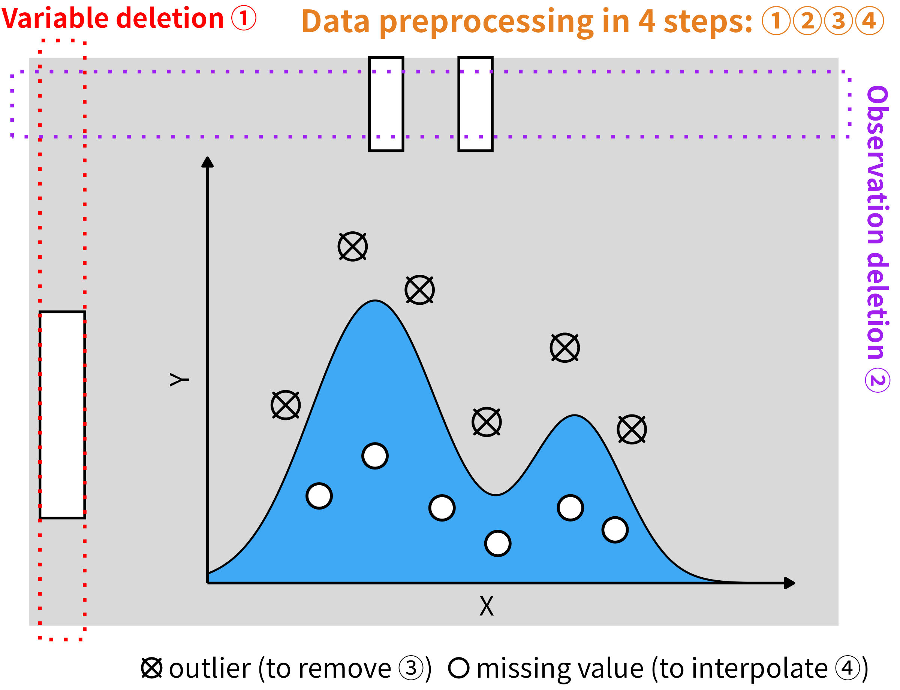
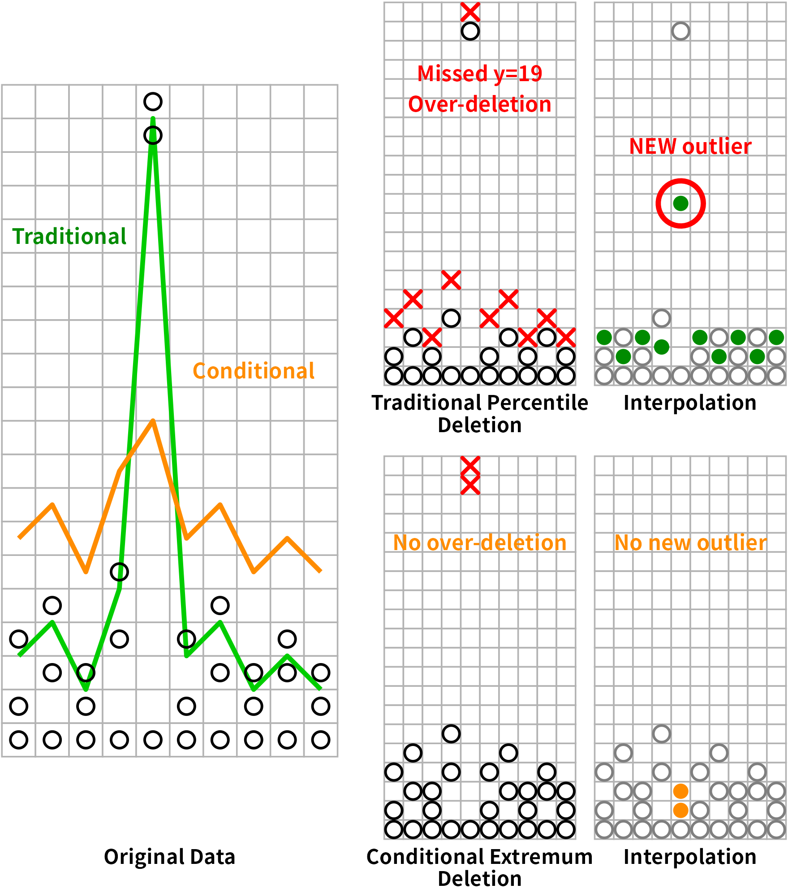
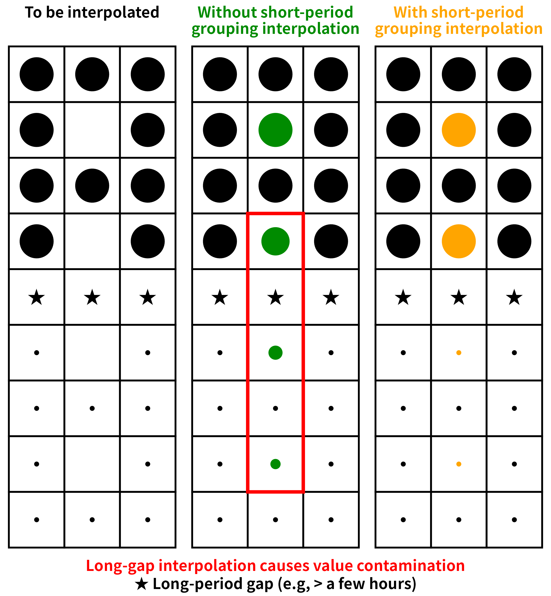

# dataprep 

<div align="right"><sub>logo by Chun-Sheng Liang</sub></div>

> Fast, efficient, and versatile data preprocessing and reshaping tools for R,
> with C++ / OpenMP / SIMD backends.

[](https://github.com/chunshengliang/dataprep/actions/workflows/R-CMD-check.yaml)
[](https://cran.r-project.org/package=dataprep)
[](https://cran.r-project.org/web/checks/check_results_dataprep.html)
[](https://cran.r-project.org/package=dataprep)
[](https://cran.r-project.org/package=dataprep)
[](https://stackoverflow.com/questions/tagged/dataprep)
[](https://deepwiki.com/chunshengliang/dataprep)


## In one paragraph

`dataprep` provides an opinionated, high-performance pipeline for
cleaning tabular and time-series data. The 0.1.8.1 release rewrites
the cleaning routines in C++ and delivers a speedup over 0.1.5 that
ranges from about **1.0×** (for `varidele` on some full-year data)
to about **1146×** (for `condextr` on full-year Ubuntu data). The
`melt()` and `dcast()` reshaping functions are benchmarked against
every one of the **eight** major alternatives in the R and Python
ecosystems, at every tested scale (from 1,000 to 100,000,000 rows),
on two reference hosts; the resulting speed-up ranges are
**0.3×–1750.0×** for `melt()`, **0.9×–1849.5×** for `dcast()`, and **2.0×–872.4×** for aggregated `dcast()`. On both
hosts the output is **identical** to `reshape2`, `data.table`,
`tidyr`, `collapse`, `pandas`, `polars`, `dask`, and `duckdb`.

## Why dataprep

`dataprep` provides a coherent, opinionated pipeline for
preprocessing tabular and time-series data:

* **Variable deletion** by missing-value fraction (`varidele`).
* **Observation deletion** by consecutive missing runs (`obsedele`).
* **Outlier removal** by point-by-point weighted conditional
  extremum (`condextr`) or by percentile (`percoutl`).
* **Missing-value imputation** within short periods (`shorvalu`)
  or by linear / LOCF / NOCB / mean / median (`impute_missing`).
* **Fast reshaping** between wide and long formats (`melt`,
  `dcast`) with SIMD + OpenMP.
* **Descriptive statistics, diagnostics, transformation,
  standardization, encoding, validation, and reporting.**
* **Time-series tools**: detrending, diurnal-cycle removal,
  rolling statistics, lags, resampling, decomposition, drift
  detection, day/night and season flags.
* **Fit / transform interfaces** (`prep_fit`, `prep_transform`)
  that prevent data leakage during preprocessing.

Most heavy routines are written in C++ with Rcpp. Since 0.1.8.1,
many operations are parallelized with OpenMP and vectorized with
AVX2 / AVX-512 when the hardware supports it.

## Design philosophy

The cleaning pipeline is organised around four sequential steps,
each addressing a distinct failure mode of high-resolution
environmental data:

<p align="center">
  
</p>

1. **Variable deletion.** Drop size bins whose missing fraction
   exceeds a threshold, so downstream interpolation never has to
   extrapolate from far-away anchors.
2. **Observation deletion.** Drop rows whose selected columns
   contain a consecutive missing run longer than `half` minutes
   on **both** sides. Every remaining point then has a trustworthy
   anchor within `half` minutes.
3. **Conditional extremum outlier removal.** A single value can
   be a global maximum and still be legitimate, or vice versa.
   `condextr()` judges each candidate in context.

   <div align="center">
     
   </div>

4. **Short-period grouping interpolation.** After steps 1–3,
   remaining `NA`s sit inside short gaps with a valid anchor
   within `half` minutes. `shorvalu()` interpolates within each
   short segment only.

   <div align="center">
     
   </div>

   Interpolating across a long gap silently mixes two physically
   distinct regimes and can create new outliers at the segment
   boundary. Grouping by short segments keeps the interpolation
   local.

Steps 1–4 are wrapped by `dataprep()` for one-call use. The design
reasoning is documented in full in
`vignette("dataprep-philosophy")`. `data1` in this package is the
**already-aggregated** seven-column version of the same dataset;
it is not a useful input for the cleaning pipeline.

## Installation

**Recommended** (also builds the vignettes locally; needs `pandoc`
and the R packages `knitr` and `rmarkdown`):

```r
# install.packages("remotes")
remotes::install_github("chunshengliang/dataprep", build_vignettes = TRUE)
```

**Fallback** (no extra dependencies):

```r
remotes::install_github("chunshengliang/dataprep")
```

The package requires a C++17 compiler (Rtools on Windows,
Xcode / clang on macOS, gcc on Linux). The `build_vignettes = TRUE`
variant additionally needs `pandoc` and the R packages `knitr` and
`rmarkdown`; if any of those is missing, `remotes` will fail. Vignettes
are also available on the package website:
<https://chunshengliang.github.io/dataprep/articles/>.

**Note for Windows users**

When installing from GitHub with `remotes::install_github()`, Windows
users may see:

> Warning: file 'dataprep/configure' did not have execute permissions: corrected
>
> Warning: file 'dataprep/cleanup' did not have execute permissions: corrected

This is expected and harmless. Windows NTFS does not preserve Unix
execute bits, so `R CMD build` corrects them automatically. The
`configure.win` and `cleanup.win` scripts still run, and the package
installs and works normally — **the warning does not affect any
functionality in any way**. Linux, macOS, and CRAN checks do not emit
this warning, and Windows users installing the CRAN binary package
with `install.packages("dataprep")` are not affected either.

## Quick start

```r
library(dataprep)

# The size-bin columns are the ones whose names are numeric
# (1.00, 1.12, ..., 1000). The four non-size columns
# (`date`, `tconc`, `TPNC`, `monthyear`) are excluded by this
# pattern.
size_bins <- grep("^[-+]?[0-9]*\\.?[0-9]+$", names(data))

cleaned <- dataprep(
  data,
  cols       = size_bins,
  group      = 4,        # monthyear
  interval   = 10,
  times      = 10,
  intervals  = 30
)
dim(cleaned)
```

## Performance

`melt()` and `dcast()` are benchmarked against all **eight** major
alternatives across 10 shapes and 6 scales (1,000 to
100,000,000 rows). Every cell is measured with a C++ steady-clock
timer and an adaptive `times` rule (20 / 15 / 10 / 5 / 1 iterations
based on warmup time). Two reference hosts were used.


### Reference host A — Ubuntu 25.10

| Component | Value |
|---|---|
| OS | Ubuntu 25.10 (Questing Quokka), kernel 6.17.0-41-generic |
| CPU | 2× AMD EPYC 9965 192-Core Processor (Turin, Zen 5c) |
| Physical cores | 384 (2 × 192) |
| Logical cores | 768 (SMT-2) |
| L1d / L1i | 18 MiB / 12 MiB |
| L2 | 384 MiB |
| L3 | 768 MiB |
| NUMA nodes | 2 |
| RAM | 1.0 TiB (16 × 64 GiB Micron, DDR5-5600, Multi-bit ECC) |
| Max frequency | 3.70 GHz |
| AVX-512 | Full (f, dq, ifma, cd, bw, vl, vbmi, vbmi2, vnni, bitalg, vpopcntdq, bf16) |
| R | 4.5.1 (2025-06-13) |
| Compiler | g++ 15.2.0 |
| reticulate | 1.47.0 |
| data.table | 1.18.6.1 |
| reshape2 | 1.4.5 |
| tidyr | 1.3.2 |
| Python | 3.13.7 |
| pandas | 3.0.6 |
| polars | 1.44.2 (runtime rt64) |
| dask | 2026.8.0 |
| duckdb | 1.5.5 |

### Reference host B — Windows 11 Pro for Workstations

| Component | Value |
|---|---|
| OS | Windows 11 Pro for Workstations, 10.0.26100, Build 26100 |
| CPU | 2× AMD EPYC 7B12 64-Core Processor |
| Physical cores | 128 (2 × 64) |
| Logical cores | 128 (no SMT) |
| L1d / L1i | 4 MiB / 4 MiB |
| L2 | 64 MiB |
| L3 | 512 MiB |
| NUMA nodes | 2 |
| RAM | about 224 GiB (7 × 32 GiB, 2933 MT/s, Micron / Samsung, non-ECC) |
| Max frequency | 2.25 GHz |
| AVX | AVX, AVX2 (no AVX-512) |
| R | 4.6.1 (2026-06-24 ucrt) |
| Compiler | GCC 14.3.0 |
| reticulate | 1.47.0 |
| data.table | 1.18.6.1 |
| reshape2 | 1.4.5 |
| tidyr | 1.3.2 |
| Python | 3.13.15 |
| pandas | 3.0.6 |
| polars | 1.44.2 (runtime rt64) |
| dask | 2026.8.0 |
| duckdb | 1.5.5 |

The two hosts differ in core count, cache size and memory
bandwidth. The relative ranking of the engines is identical on
both; the absolute multipliers scale with the hardware. On a
typical 8–16-core workstation the same comparisons remain within
10–100×.

All numbers below are **medians** in milliseconds. Each cell is
written as `time (speedup×)`, where `time` is the median for that
engine and `speedup×` is `time / dataprep_time`. The `dataprep`
column itself is the baseline, so it has no multiplier.

### `melt()` — Ubuntu 25.10

**Vary rows, 1 id + 9 value columns**

| rows | dataprep | reshape2 | data.table | tidyr | collapse | pandas | polars | dask | duckdb |
|---:|---:|---:|---:|---:|---:|---:|---:|---:|---:|
| 1e3 | 0.152 | 0.410 (2.7×) | 0.260 (1.7×) | 2.805 (18.4×) | 0.175 (1.1×) | 2.195 (14.4×) | 0.594 (3.9×) | 15.1 (99.0×) | 5.435 (35.7×) |
| 1e4 | 0.243 | 0.453 (1.9×) | 0.346 (1.4×) | 3.305 (13.6×) | 0.248 (1.0×) | 2.644 (10.9×) | 0.689 (2.8×) | 15.1 (62.2×) | 12.5 (51.3×) |
| 1e5 | 0.380 | 1.172 (3.1×) | 1.038 (2.7×) | 8.204 (21.6×) | 0.812 (2.1×) | 6.824 (17.9×) | 1.558 (4.1×) | 17.4 (45.9×) | 89.3 (234.8×) |
| 1e6 | 1.441 | 8.145 (5.7×) | 7.937 (5.5×) | 65.8 (45.7×) | 6.542 (4.5×) | 60.7 (42.2×) | 10.6 (7.4×) | 46.1 (32.0×) | 758.1 (526.2×) |
| 1e7 | 38.0 | 368.8 (9.7×) | 368.8 (9.7×) | 1094 (28.7×) | 317.2 (8.3×) | 718.5 (18.9×) | 93.0 (2.4×) | 507.2 (13.3×) | 7418 (195.0×) |
| 1e8 | 398.6 | 3592 (9.0×) | 3584 (9.0×) | 11788 (29.6×) | 3632 (9.1×) | 7388 (18.5×) | 2597 (6.5×) | 4550 (11.4×) | 87982 (220.7×) |

**Vary rows, 10 id (5 int + 5 chr)**

| rows | dataprep | reshape2 | data.table | tidyr | collapse | pandas | polars | dask | duckdb |
|---:|---:|---:|---:|---:|---:|---:|---:|---:|---:|
| 1e3 | 0.207 | 0.576 (2.8×) | 0.432 (2.1×) | 3.164 (15.3×) | 0.235 (1.1×) | 5.831 (28.2×) | 1.156 (5.6×) | 53.9 (260.7×) | 12.0 (57.9×) |
| 1e4 | 0.505 | 2.018 (4.0×) | 1.775 (3.5×) | 4.865 (9.6×) | 0.580 (1.1×) | 6.384 (12.7×) | 1.770 (3.5×) | 54.8 (108.6×) | 67.1 (133.0×) |
| 1e5 | 2.191 | 16.4 (7.5×) | 15.0 (6.8×) | 22.9 (10.5×) | 3.979 (1.8×) | 13.6 (6.2×) | 4.052 (1.8×) | 58.6 (26.7×) | 573.6 (261.8×) |
| 1e6 | 17.7 | 185.5 (10.5×) | 146.9 (8.3×) | 210.2 (11.9×) | 39.2 (2.2×) | 90.1 (5.1×) | 25.4 (1.4×) | 112.6 (6.4×) | 5663 (320.5×) |
| 1e7 | 777.8 | 2901 (3.7×) | 2694 (3.5×) | 3322 (4.3×) | 1667 (2.1×) | 1267 (1.6×) | 268.7 (0.3×) | 994.4 (1.3×) | 57499 (73.9×) |

**Vary value columns, 1e3 rows, 1 id**

| n_val | dataprep | reshape2 | data.table | tidyr | collapse | pandas | polars | dask | duckdb |
|---:|---:|---:|---:|---:|---:|---:|---:|---:|---:|
| 10 | 0.165 | 0.417 (2.5×) | 0.281 (1.7×) | 2.860 (17.3×) | 0.180 (1.1×) | 2.276 (13.8×) | 0.613 (3.7×) | 16.1 (97.2×) | 5.476 (33.1×) |
| 100 | 0.267 | 1.108 (4.2×) | 0.382 (1.4×) | 3.681 (13.8×) | 0.284 (1.1×) | 6.669 (25.0×) | 0.742 (2.8×) | 47.5 (178.0×) | 22.5 (84.3×) |
| 1000 | 0.647 | 7.972 (12.3×) | 1.250 (1.9×) | 11.7 (18.1×) | 1.148 (1.8×) | 48.8 (75.5×) | 2.069 (3.2×) | 366.4 (566.3×) | 196.3 (303.3×) |
| 10000 | 2.176 | 78.3 (36.0×) | 9.710 (4.5×) | 93.5 (43.0×) | 9.285 (4.3×) | 501.2 (230.3×) | 16.3 (7.5×) | 3809 (1750.0×) | 2048 (940.9×) |

**Vary value columns, 1e3 rows, 10 id**

| n_val | dataprep | reshape2 | data.table | tidyr | collapse | pandas | polars | dask | duckdb |
|---:|---:|---:|---:|---:|---:|---:|---:|---:|---:|
| 10 | 0.206 | 0.586 (2.9×) | 0.434 (2.1×) | 3.024 (14.7×) | 0.232 (1.1×) | 5.859 (28.5×) | 0.922 (4.5×) | 49.6 (241.3×) | 13.9 (67.7×) |
| 100 | 0.526 | 2.830 (5.4×) | 1.961 (3.7×) | 5.417 (10.3×) | 0.717 (1.4×) | 21.0 (39.9×) | 2.172 (4.1×) | 150.6 (286.6×) | 72.4 (137.7×) |
| 1000 | 2.597 | 25.0 (9.6×) | 16.7 (6.4×) | 28.5 (11.0×) | 5.299 (2.0×) | 169.6 (65.3×) | 5.799 (2.2×) | 1375 (529.7×) | 653.2 (251.6×) |
| 10000 | 22.6 | 279.9 (12.4×) | 170.1 (7.5×) | 256.9 (11.4×) | 49.4 (2.2×) | 1808 (80.0×) | 64.2 (2.8×) | 18730 (828.1×) | 6573 (290.6×) |
### `melt()` — Windows 11 Pro for Workstations

**Vary rows, 1 id + 9 value columns**

| rows | dataprep | reshape2 | data.table | tidyr | collapse | pandas | polars | dask | duckdb |
|---:|---:|---:|---:|---:|---:|---:|---:|---:|---:|
| 1e3 | 0.300 | 0.693 (2.3×) | 0.516 (1.7×) | 4.015 (13.4×) | 0.313 (1.0×) | 3.570 (11.9×) | 0.597 (2.0×) | 29.3 (97.7×) | 7.877 (26.3×) |
| 1e4 | 0.580 | 0.926 (1.6×) | 0.797 (1.4×) | 5.026 (8.7×) | 0.592 (1.0×) | 4.962 (8.6×) | 0.862 (1.5×) | 31.7 (54.6×) | 23.8 (41.1×) |
| 1e5 | 3.493 | 3.554 (1.0×) | 3.129 (0.9×) | 16.4 (4.7×) | 2.945 (0.8×) | 25.9 (7.4×) | 2.923 (0.8×) | 46.6 (13.3×) | 179.2 (51.3×) |
| 1e6 | 18.0 | 23.9 (1.3×) | 23.6 (1.3×) | 157.4 (8.7×) | 23.2 (1.3×) | 182.8 (10.2×) | 17.8 (1.0×) | 185.9 (10.3×) | 1546 (85.9×) |
| 1e7 | 152.7 | 236.9 (1.6×) | 238.0 (1.6×) | 1501 (9.8×) | 235.1 (1.5×) | 1885 (12.3×) | 162.5 (1.1×) | 1515 (9.9×) | 14435 (94.5×) |
| 1e8 | 1773 | 3295 (1.9×) | 2419 (1.4×) | 20809 (11.7×) | 2516 (1.4×) | 22699 (12.8×) | 5510 (3.1×) | 15429 (8.7×) | 161372 (91.0×) |

**Vary rows, 10 id (5 int + 5 chr)**

| rows | dataprep | reshape2 | data.table | tidyr | collapse | pandas | polars | dask | duckdb |
|---:|---:|---:|---:|---:|---:|---:|---:|---:|---:|
| 1e3 | 0.434 | 1.096 (2.5×) | 0.861 (2.0×) | 4.412 (10.2×) | 0.468 (1.1×) | 11.2 (25.7×) | 1.220 (2.8×) | 98.3 (226.4×) | 19.8 (45.6×) |
| 1e4 | 1.410 | 5.255 (3.7×) | 3.580 (2.5×) | 8.191 (5.8×) | 1.601 (1.1×) | 14.3 (10.1×) | 1.853 (1.3×) | 104.0 (73.7×) | 121.6 (86.3×) |
| 1e5 | 12.9 | 43.8 (3.4×) | 29.1 (2.3×) | 44.9 (3.5×) | 12.9 (1.0×) | 43.7 (3.4×) | 7.974 (0.6×) | 132.4 (10.3×) | 993.8 (77.2×) |
| 1e6 | 100.0 | 371.9 (3.7×) | 269.3 (2.7×) | 434.9 (4.4×) | 129.4 (1.3×) | 340.0 (3.4×) | 72.1 (0.7×) | 367.9 (3.7×) | 9795 (98.0×) |
| 1e7 | 1009 | 3675 (3.6×) | 2683 (2.7×) | 4217 (4.2×) | 1413 (1.4×) | 3158 (3.1×) | 1007 (1.0×) | 2741 (2.7×) | 97022 (96.1×) |

**Vary value columns, 1e3 rows, 1 id**

| n_val | dataprep | reshape2 | data.table | tidyr | collapse | pandas | polars | dask | duckdb |
|---:|---:|---:|---:|---:|---:|---:|---:|---:|---:|
| 10 | 0.359 | 0.746 (2.1×) | 0.576 (1.6×) | 4.043 (11.3×) | 0.375 (1.0×) | 3.484 (9.7×) | 0.552 (1.5×) | 27.5 (76.5×) | 10.3 (28.6×) |
| 100 | 0.760 | 2.294 (3.0×) | 1.054 (1.4×) | 5.844 (7.7×) | 0.825 (1.1×) | 16.1 (21.2×) | 0.910 (1.2×) | 111.1 (146.1×) | 52.5 (69.0×) |
| 1000 | 4.057 | 15.9 (3.9×) | 3.911 (1.0×) | 23.3 (5.7×) | 3.477 (0.9×) | 140.4 (34.6×) | 3.613 (0.9×) | 960.5 (236.8×) | 435.0 (107.2×) |
| 10000 | 31.7 | 168.6 (5.3×) | 32.7 (1.0×) | 201.7 (6.4×) | 34.7 (1.1×) | 1412 (44.6×) | 30.0 (0.9×) | 10253 (323.6×) | 5112 (161.4×) |

**Vary value columns, 1e3 rows, 10 id**

| n_val | dataprep | reshape2 | data.table | tidyr | collapse | pandas | polars | dask | duckdb |
|---:|---:|---:|---:|---:|---:|---:|---:|---:|---:|
| 10 | 0.467 | 1.175 (2.5×) | 0.881 (1.9×) | 4.464 (9.6×) | 0.503 (1.1×) | 11.6 (24.8×) | 1.213 (2.6×) | 101.5 (217.2×) | 21.4 (45.8×) |
| 100 | 1.430 | 6.471 (4.5×) | 3.557 (2.5×) | 9.033 (6.3×) | 1.716 (1.2×) | 67.7 (47.3×) | 2.718 (1.9×) | 503.7 (352.3×) | 129.3 (90.4×) |
| 1000 | 12.9 | 53.9 (4.2×) | 30.9 (2.4×) | 54.8 (4.2×) | 15.3 (1.2×) | 607.4 (47.1×) | 12.5 (1.0×) | 4819 (373.5×) | 1221 (94.6×) |
| 10000 | 120.1 | 582.6 (4.8×) | 347.3 (2.9×) | 509.9 (4.2×) | 156.9 (1.3×) | 5682 (47.3×) | 105.9 (0.9×) | 52276 (435.2×) | 12743 (106.1×) |
### `dcast()` — Ubuntu 25.10

**Vary n_long, 1 id, 10 levels**

| n_long | dataprep | reshape2 | data.table | tidyr | collapse | pandas | polars | dask | duckdb |
|---:|---:|---:|---:|---:|---:|---:|---:|---:|---:|
| 1e3 | 0.105 | 1.756 (16.7×) | 1.883 (17.9×) | 4.358 (41.4×) | 0.270 (2.6×) | 2.073 (19.7×) | 27.0 (256.8×) | 8.642 (82.1×) | 8.306 (78.9×) |
| 1e4 | 0.162 | 2.590 (16.0×) | 2.564 (15.9×) | 4.519 (27.9×) | 0.313 (1.9×) | 2.545 (15.7×) | 35.0 (216.4×) | 9.278 (57.4×) | 12.0 (74.0×) |
| 1e5 | 0.345 | 20.8 (60.2×) | 14.5 (41.9×) | 7.763 (22.5×) | 0.777 (2.3×) | 7.115 (20.6×) | 49.6 (143.6×) | 15.9 (46.2×) | 41.4 (119.8×) |
| 1e6 | 1.075 | 139.2 (129.5×) | 323.7 (301.0×) | 46.5 (43.3×) | 4.917 (4.6×) | 56.4 (52.5×) | 94.2 (87.6×) | 81.7 (76.0×) | 242.0 (225.0×) |
| 1e7 | 8.019 | 1850 (230.7×) | 600.9 (74.9×) | 741.3 (92.4×) | 47.0 (5.9×) | 753.5 (94.0×) | 293.1 (36.6×) | 924.1 (115.2×) | 2504 (312.2×) |
| 1e8 | 84.0 | 21204 (252.6×) | 17261 (205.6×) | 9504 (113.2×) | 497.2 (5.9×) | 10370 (123.5×) | 2373 (28.3×) | 13332 (158.8×) | 24768 (295.0×) |

**Vary n_long, 1 id, 100 levels**

| n_long | dataprep | reshape2 | data.table | tidyr | collapse | pandas | polars | dask | duckdb |
|---:|---:|---:|---:|---:|---:|---:|---:|---:|---:|
| 1e4 | 0.181 | 2.746 (15.2×) | 2.767 (15.3×) | 4.645 (25.6×) | 0.329 (1.8×) | 2.659 (14.7×) | 37.9 (209.1×) | 9.814 (54.2×) | 16.0 (88.3×) |
| 1e5 | 0.328 | 18.8 (57.4×) | 8.502 (26.0×) | 7.884 (24.1×) | 0.815 (2.5×) | 7.112 (21.7×) | 54.7 (167.0×) | 15.2 (46.3×) | 49.9 (152.4×) |
| 1e6 | 0.585 | 102.8 (175.6×) | 346.7 (592.4×) | 44.2 (75.5×) | 5.021 (8.6×) | 54.7 (93.5×) | 176.1 (300.9×) | 76.2 (130.3×) | 258.8 (442.2×) |
| 1e7 | 3.845 | 2016 (524.4×) | 595.9 (155.0×) | 684.3 (178.0×) | 52.7 (13.7×) | 742.5 (193.1×) | 474.5 (123.4×) | 941.3 (244.8×) | 2505 (651.5×) |
| 1e8 | 37.9 | 16777 (443.0×) | 18782 (495.9×) | 8285 (218.8×) | 499.3 (13.2×) | 9587 (253.1×) | 2509 (66.3×) | 12155 (320.9×) | 24486 (646.5×) |

**Vary levels, 1 id, 1e6 rows**

| levels | dataprep | reshape2 | data.table | tidyr | collapse | pandas | polars | dask | duckdb |
|---:|---:|---:|---:|---:|---:|---:|---:|---:|---:|
| 10 | 1.075 | 139.2 (129.5×) | 323.7 (301.0×) | 46.5 (43.3×) | 4.917 (4.6×) | 56.4 (52.5×) | 94.2 (87.6×) | 81.7 (76.0×) | 242.0 (225.0×) |
| 100 | 0.585 | 102.8 (175.6×) | 346.7 (592.4×) | 44.2 (75.5×) | 5.021 (8.6×) | 54.7 (93.5×) | 176.1 (300.9×) | 76.2 (130.3×) | 258.8 (442.2×) |
| 1000 | 0.906 | 101.7 (112.3×) | 227.0 (250.6×) | 43.9 (48.5×) | 5.437 (6.0×) | 56.7 (62.6×) | 184.0 (203.2×) | 78.1 (86.3×) | 275.5 (304.1×) |
| 10000 | 2.477 | 123.4 (49.8×) | 452.9 (182.9×) | 56.2 (22.7×) | 6.529 (2.6×) | 60.7 (24.5×) | 310.4 (125.3×) | 82.1 (33.1×) | 580.3 (234.3×) |

**Vary n_id, 1e6 rows, 10 levels**

| n_id | dataprep | reshape2 | data.table | tidyr | collapse | pandas | polars | dask | duckdb |
|---:|---:|---:|---:|---:|---:|---:|---:|---:|---:|
| 1 | 1.075 | 139.2 (129.5×) | 323.7 (301.0×) | 46.5 (43.3×) | 4.917 (4.6×) | 56.4 (52.5×) | 94.2 (87.6×) | 81.7 (76.0×) | 242.0 (225.0×) |
| 10 | 3.556 | 1201 (337.7×) | 457.8 (128.7×) | 85.1 (23.9×) | 24.6 (6.9×) | 186.3 (52.4×) | 113.1 (31.8×) | 240.7 (67.7×) | 1366 (384.3×) |
### `dcast()` — Windows 11 Pro for Workstations

**Vary n_long, 1 id, 10 levels**

| n_long | dataprep | reshape2 | data.table | tidyr | collapse | pandas | polars | dask | duckdb |
|---:|---:|---:|---:|---:|---:|---:|---:|---:|---:|
| 1e3 | 0.353 | 2.185 (6.2×) | 3.673 (10.4×) | 6.248 (17.7×) | 0.325 (0.9×) | 2.351 (6.7×) | 4.699 (13.3×) | 14.9 (42.3×) | 20.8 (59.0×) |
| 1e4 | 0.505 | 4.133 (8.2×) | 7.698 (15.3×) | 7.550 (15.0×) | 0.777 (1.5×) | 4.620 (9.2×) | 5.647 (11.2×) | 18.0 (35.6×) | 25.7 (50.9×) |
| 1e5 | 0.847 | 30.7 (36.2×) | 38.6 (45.6×) | 15.5 (18.3×) | 2.286 (2.7×) | 20.3 (24.0×) | 12.4 (14.7×) | 41.5 (49.0×) | 73.2 (86.4×) |
| 1e6 | 2.977 | 239.6 (80.5×) | 154.7 (52.0×) | 112.8 (37.9×) | 14.2 (4.8×) | 239.5 (80.5×) | 53.0 (17.8×) | 359.4 (120.8×) | 385.6 (129.6×) |
| 1e7 | 19.7 | 2550 (129.5×) | 1038 (52.7×) | 1393 (70.7×) | 118.1 (6.0×) | 2490 (126.4×) | 534.5 (27.1×) | 3224 (163.7×) | 3444 (174.9×) |
| 1e8 | 183.2 | 27499 (150.1×) | 12540 (68.4×) | 15113 (82.5×) | 1167 (6.4×) | 30323 (165.5×) | 5340 (29.1×) | 36734 (200.5×) | 33128 (180.8×) |

**Vary n_long, 1 id, 100 levels**

| n_long | dataprep | reshape2 | data.table | tidyr | collapse | pandas | polars | dask | duckdb |
|---:|---:|---:|---:|---:|---:|---:|---:|---:|---:|
| 1e4 | 0.694 | 4.733 (6.8×) | 8.769 (12.6×) | 7.967 (11.5×) | 0.965 (1.4×) | 5.636 (8.1×) | 10.2 (14.8×) | 17.3 (25.0×) | 87.9 (126.7×) |
| 1e5 | 0.610 | 33.4 (54.8×) | 41.0 (67.3×) | 18.8 (30.8×) | 3.453 (5.7×) | 34.6 (56.7×) | 14.4 (23.6×) | 65.2 (107.0×) | 289.6 (475.2×) |
| 1e6 | 3.999 | 173.3 (43.3×) | 179.5 (44.9×) | 82.1 (20.5×) | 14.2 (3.6×) | 226.4 (56.6×) | 71.8 (18.0×) | 308.5 (77.1×) | 800.0 (200.0×) |
| 1e7 | 32.7 | 2855 (87.3×) | 1119 (34.2×) | 1220 (37.3×) | 156.7 (4.8×) | 2259 (69.1×) | 1217 (37.2×) | 2967 (90.7×) | 7389 (226.0×) |
| 1e8 | 105.9 | 22379 (211.3×) | 14723 (139.0×) | 12879 (121.6×) | 1477 (13.9×) | 25000 (236.0×) | 8290 (78.3×) | 31519 (297.5×) | 82310 (777.0×) |

**Vary levels, 1 id, 1e6 rows**

| levels | dataprep | reshape2 | data.table | tidyr | collapse | pandas | polars | dask | duckdb |
|---:|---:|---:|---:|---:|---:|---:|---:|---:|---:|
| 10 | 2.977 | 239.6 (80.5×) | 154.7 (52.0×) | 112.8 (37.9×) | 14.2 (4.8×) | 239.5 (80.5×) | 53.0 (17.8×) | 359.4 (120.8×) | 385.6 (129.6×) |
| 100 | 3.999 | 173.3 (43.3×) | 179.5 (44.9×) | 82.1 (20.5×) | 14.2 (3.6×) | 226.4 (56.6×) | 71.8 (18.0×) | 308.5 (77.1×) | 800.0 (200.0×) |
| 1000 | 2.199 | 167.9 (76.4×) | 167.4 (76.1×) | 92.6 (42.1×) | 13.9 (6.3×) | 256.4 (116.6×) | 232.8 (105.9×) | 308.6 (140.4×) | 1107 (503.4×) |
| 10000 | 6.971 | 234.8 (33.7×) | 178.2 (25.6×) | 109.8 (15.8×) | 20.4 (2.9×) | 275.7 (39.5×) | 1712 (245.6×) | 322.9 (46.3×) | 12893 (1849.5×) |

**Vary n_id, 1e6 rows, 10 levels**

| n_id | dataprep | reshape2 | data.table | tidyr | collapse | pandas | polars | dask | duckdb |
|---:|---:|---:|---:|---:|---:|---:|---:|---:|---:|
| 1 | 2.977 | 239.6 (80.5×) | 154.7 (52.0×) | 112.8 (37.9×) | 14.2 (4.8×) | 239.5 (80.5×) | 53.0 (17.8×) | 359.4 (120.8×) | 385.6 (129.6×) |
| 10 | 13.6 | 2596 (190.3×) | 312.6 (22.9×) | 159.6 (11.7×) | 127.6 (9.4×) | 831.3 (61.0×) | 77.5 (5.7×) | 1062 (77.9×) | 2051 (150.4×) |

### Aggregated `dcast()` — `fun.aggregate`

Input is a canonical long table where every `(id, variable)` pair
appears exactly `K = 3` times. Five aggregation functions (`sum`,
`mean`, `min`, `max`, `count`) are measured across five scales
(1e4 to 1e8 rows). Medians in milliseconds; `speedup×` is
`competitor_median / dataprep_median`.

**Ubuntu 25.10**

| agg | n_long | dataprep | reshape2 | data.table | tidyr | collapse | pandas | polars | dask | duckdb |
|---:|---:|---:|---:|---:|---:|---:|---:|---:|---:|---:|
| sum | 1e4 | 0.361 | 7.456 (20.7×) | 13.1 (36.3×) | 6.863 (19.0×) | 1.326 (3.7×) | 4.214 (11.7×) | 44.3 (122.7×) | 9.549 (26.5×) | 11.2 (31.0×) |
| sum | 1e5 | 1.098 | 58.0 (52.8×) | 99.8 (90.9×) | 24.1 (22.0×) | 9.103 (8.3×) | 7.685 (7.0×) | 67.6 (61.5×) | 12.9 (11.7×) | 39.9 (36.3×) |
| sum | 1e6 | 8.248 | 578.3 (70.1×) | 1277 (154.8×) | 235.2 (28.5×) | 102.8 (12.5×) | 42.7 (5.2×) | 169.5 (20.6×) | 48.3 (5.9×) | 226.3 (27.4×) |
| sum | 1e7 | 81.3 | 6096 (75.0×) | 9264 (113.9×) | 3149 (38.7×) | 1579 (19.4×) | 461.6 (5.7×) | 440.3 (5.4×) | 463.7 (5.7×) | 2441 (30.0×) |
| sum | 1e8 | 802.2 | 61358 (76.5×) | 100481 (125.3×) | 33633 (41.9×) | 17333 (21.6×) | 6123 (7.6×) | 2247 (2.8×) | 6198 (7.7×) | 24414 (30.4×) |
| mean | 1e4 | 0.349 | 13.4 (38.2×) | 20.0 (57.2×) | 13.0 (37.2×) | 7.437 (21.3×) | 4.250 (12.2×) | 39.7 (113.8×) | 9.388 (26.9×) | 11.4 (32.6×) |
| mean | 1e5 | 1.132 | 130.5 (115.3×) | 184.9 (163.4×) | 93.9 (82.9×) | 71.7 (63.4×) | 7.841 (6.9×) | 53.3 (47.1×) | 13.1 (11.6×) | 39.7 (35.1×) |
| mean | 1e6 | 8.749 | 1238 (141.5×) | 2060 (235.5×) | 1020 (116.5×) | 788.5 (90.1×) | 43.5 (5.0×) | 137.9 (15.8×) | 49.2 (5.6×) | 231.7 (26.5×) |
| mean | 1e7 | 87.8 | 12731 (145.0×) | 17215 (196.1×) | 12040 (137.2×) | 9395 (107.0×) | 470.0 (5.4×) | 438.5 (5.0×) | 477.1 (5.4×) | 2404 (27.4×) |
| mean | 1e8 | 840.0 | 126353 (150.4×) | 176405 (210.0×) | 123259 (146.7×) | 95859 (114.1×) | 5727 (6.8×) | 2544 (3.0×) | 5811 (6.9×) | 23826 (28.4×) |
| min | 1e4 | 0.331 | 61.3 (185.5×) | 12.2 (37.0×) | 6.353 (19.2×) | 1.272 (3.8×) | 4.175 (12.6×) | 36.9 (111.8×) | 9.305 (28.1×) | 11.4 (34.6×) |
| min | 1e5 | 1.080 | 619.0 (573.2×) | 99.7 (92.3×) | 24.3 (22.5×) | 9.068 (8.4×) | 8.171 (7.6×) | 54.3 (50.3×) | 13.3 (12.3×) | 39.7 (36.8×) |
| min | 1e6 | 8.391 | 6102 (727.2×) | 1233 (147.0×) | 229.0 (27.3×) | 89.6 (10.7×) | 43.8 (5.2×) | 131.8 (15.7×) | 49.6 (5.9×) | 229.3 (27.3×) |
| min | 1e7 | 83.2 | 61001 (733.5×) | 9280 (111.6×) | 2985 (35.9×) | 1584 (19.0×) | 480.7 (5.8×) | 428.2 (5.1×) | 487.9 (5.9×) | 2435 (29.3×) |
| min | 1e8 | 822.4 | 583807 (709.9×) | 98298 (119.5×) | 33490 (40.7×) | 15748 (19.1×) | 5984 (7.3×) | 2455 (3.0×) | 6339 (7.7×) | 24143 (29.4×) |
| max | 1e4 | 0.336 | 61.6 (183.3×) | 12.2 (36.3×) | 6.380 (19.0×) | 1.266 (3.8×) | 4.248 (12.6×) | 37.1 (110.5×) | 9.342 (27.8×) | 11.4 (33.8×) |
| max | 1e5 | 1.101 | 621.2 (564.3×) | 99.6 (90.5×) | 23.9 (21.7×) | 8.855 (8.0×) | 7.861 (7.1×) | 54.5 (49.5×) | 13.0 (11.8×) | 40.5 (36.8×) |
| max | 1e6 | 8.682 | 6150 (708.4×) | 1242 (143.1×) | 229.8 (26.5×) | 88.6 (10.2×) | 48.5 (5.6×) | 130.9 (15.1×) | 54.8 (6.3×) | 238.2 (27.4×) |
| max | 1e7 | 84.9 | 60865 (717.2×) | 9282 (109.4×) | 3042 (35.9×) | 1609 (19.0×) | 478.8 (5.6×) | 419.4 (4.9×) | 482.0 (5.7×) | 2372 (28.0×) |
| max | 1e8 | 852.1 | 585064 (686.6×) | 98892 (116.1×) | 30419 (35.7×) | 16114 (18.9×) | 5786 (6.8×) | 2367 (2.8×) | 5925 (7.0×) | 24394 (28.6×) |
| count | 1e4 | 0.327 | 5.960 (18.3×) | 11.6 (35.5×) | 5.906 (18.1×) | 0.950 (2.9×) | 4.010 (12.3×) | 32.7 (100.1×) | 8.744 (26.8×) | 11.3 (34.6×) |
| count | 1e5 | 1.001 | 46.4 (46.3×) | 94.5 (94.4×) | 20.7 (20.7×) | 5.902 (5.9×) | 7.362 (7.4×) | 39.4 (39.4×) | 12.4 (12.4×) | 40.3 (40.3×) |
| count | 1e6 | 7.506 | 483.0 (64.4×) | 1204 (160.3×) | 186.1 (24.8×) | 63.2 (8.4×) | 43.0 (5.7×) | 87.5 (11.7×) | 48.8 (6.5×) | 232.9 (31.0×) |
| count | 1e7 | 82.5 | 5002 (60.6×) | 8894 (107.8×) | 2671 (32.4×) | 1264 (15.3×) | 430.5 (5.2×) | 273.4 (3.3×) | 435.4 (5.3×) | 2362 (28.6×) |
| count | 1e8 | 816.4 | 49663 (60.8×) | 93518 (114.5×) | 24270 (29.7×) | 11898 (14.6×) | 5312 (6.5×) | 1897 (2.3×) | 5481 (6.7×) | 24073 (29.5×) |

**Windows 11 Pro for Workstations**

| agg | n_long | dataprep | reshape2 | data.table | tidyr | collapse | pandas | polars | dask | duckdb |
|---:|---:|---:|---:|---:|---:|---:|---:|---:|---:|---:|
| sum | 1e4 | 0.996 | 13.3 (13.3×) | 34.2 (34.4×) | 12.0 (12.1×) | 3.401 (3.4×) | 7.354 (7.4×) | 7.622 (7.7×) | 15.6 (15.7×) | 36.2 (36.4×) |
| sum | 1e5 | 4.626 | 114.1 (24.7×) | 235.8 (51.0×) | 57.1 (12.3×) | 27.6 (6.0×) | 35.7 (7.7×) | 14.1 (3.0×) | 46.1 (10.0×) | 96.1 (20.8×) |
| sum | 1e6 | 19.6 | 1113 (56.7×) | 2393 (122.0×) | 561.2 (28.6×) | 259.8 (13.2×) | 177.4 (9.0×) | 56.2 (2.9×) | 188.4 (9.6×) | 408.1 (20.8×) |
| sum | 1e7 | 159.5 | 11738 (73.6×) | 20070 (125.8×) | 6380 (40.0×) | 3495 (21.9×) | 1547 (9.7×) | 452.1 (2.8×) | 1579 (9.9×) | 3603 (22.6×) |
| sum | 1e8 | 1581 | 132964 (84.1×) | 199057 (125.9×) | 73704 (46.6×) | 36725 (23.2×) | 15698 (9.9×) | 4015 (2.5×) | 15549 (9.8×) | 32016 (20.3×) |
| mean | 1e4 | 1.106 | 31.6 (28.5×) | 61.7 (55.8×) | 33.6 (30.3×) | 21.6 (19.5×) | 8.789 (7.9×) | 6.711 (6.1×) | 18.9 (17.1×) | 36.8 (33.3×) |
| mean | 1e5 | 5.008 | 316.5 (63.2×) | 522.0 (104.2×) | 268.1 (53.5×) | 208.9 (41.7×) | 35.8 (7.2×) | 16.0 (3.2×) | 46.0 (9.2×) | 97.2 (19.4×) |
| mean | 1e6 | 20.0 | 2946 (147.0×) | 4273 (213.3×) | 2764 (138.0×) | 2245 (112.1×) | 172.8 (8.6×) | 62.6 (3.1×) | 185.0 (9.2×) | 410.0 (20.5×) |
| mean | 1e7 | 165.6 | 30262 (182.7×) | 41963 (253.3×) | 28408 (171.5×) | 24059 (145.3×) | 1513 (9.1×) | 579.8 (3.5×) | 1746 (10.5×) | 3331 (20.1×) |
| mean | 1e8 | 1625 | 328585 (202.2×) | 428035 (263.4×) | 294363 (181.1×) | 254503 (156.6×) | 15647 (9.6×) | 4052 (2.5×) | 16144 (9.9×) | 31085 (19.1×) |
| min | 1e4 | 1.080 | 139.0 (128.7×) | 34.5 (31.9×) | 13.9 (12.9×) | 3.486 (3.2×) | 7.892 (7.3×) | 6.350 (5.9×) | 17.4 (16.2×) | 36.6 (33.9×) |
| min | 1e5 | 4.700 | 1528 (325.2×) | 237.5 (50.5×) | 56.3 (12.0×) | 27.4 (5.8×) | 36.1 (7.7×) | 14.6 (3.1×) | 54.1 (11.5×) | 98.9 (21.1×) |
| min | 1e6 | 19.5 | 14020 (718.0×) | 2333 (119.5×) | 476.2 (24.4×) | 224.3 (11.5×) | 210.3 (10.8×) | 64.2 (3.3×) | 189.7 (9.7×) | 412.7 (21.1×) |
| min | 1e7 | 162.6 | 141674 (871.2×) | 19570 (120.3×) | 6346 (39.0×) | 3045 (18.7×) | 1518 (9.3×) | 542.8 (3.3×) | 1558 (9.6×) | 3634 (22.3×) |
| min | 1e8 | 1608 | 1402743 (872.4×) | 199609 (124.1×) | 74296 (46.2×) | 30693 (19.1×) | 16374 (10.2×) | 4029 (2.5×) | 15650 (9.7×) | 32002 (19.9×) |
| max | 1e4 | 1.075 | 139.2 (129.5×) | 34.5 (32.1×) | 13.5 (12.6×) | 3.493 (3.2×) | 8.509 (7.9×) | 6.397 (6.0×) | 18.1 (16.8×) | 36.3 (33.8×) |
| max | 1e5 | 4.819 | 1463 (303.5×) | 271.1 (56.2×) | 57.1 (11.8×) | 27.6 (5.7×) | 35.8 (7.4×) | 14.2 (2.9×) | 45.8 (9.5×) | 94.0 (19.5×) |
| max | 1e6 | 23.0 | 14022 (609.3×) | 2013 (87.5×) | 480.7 (20.9×) | 226.7 (9.8×) | 176.0 (7.6×) | 64.0 (2.8×) | 189.5 (8.2×) | 411.8 (17.9×) |
| max | 1e7 | 165.7 | 141902 (856.5×) | 19688 (118.8×) | 6272 (37.9×) | 3070 (18.5×) | 1494 (9.0×) | 580.5 (3.5×) | 1538 (9.3×) | 3678 (22.2×) |
| max | 1e8 | 1632 | 1411738 (865.2×) | 199830 (122.5×) | 73164 (44.8×) | 29333 (18.0×) | 16082 (9.9×) | 4052 (2.5×) | 15769 (9.7×) | 34345 (21.0×) |
| count | 1e4 | 1.024 | 11.4 (11.1×) | 32.7 (32.0×) | 11.4 (11.1×) | 2.900 (2.8×) | 7.662 (7.5×) | 5.619 (5.5×) | 18.2 (17.8×) | 37.5 (36.6×) |
| count | 1e5 | 4.559 | 93.7 (20.6×) | 249.8 (54.8×) | 57.8 (12.7×) | 20.1 (4.4×) | 34.8 (7.6×) | 10.1 (2.2×) | 44.9 (9.9×) | 96.1 (21.1×) |
| count | 1e6 | 22.6 | 883.1 (39.0×) | 2216 (97.9×) | 414.6 (18.3×) | 168.1 (7.4×) | 175.1 (7.7×) | 45.0 (2.0×) | 207.0 (9.1×) | 410.1 (18.1×) |
| count | 1e7 | 158.1 | 9421 (59.6×) | 19698 (124.6×) | 5770 (36.5×) | 2693 (17.0×) | 1449 (9.2×) | 428.1 (2.7×) | 1491 (9.4×) | 3424 (21.7×) |
| count | 1e8 | 1545 | 107299 (69.4×) | 197190 (127.6×) | 58430 (37.8×) | 24493 (15.8×) | 15100 (9.8×) | 3629 (2.3×) | 14865 (9.6×) | 31049 (20.1×) |
### Summary of speedups

Speedup is defined as `competitor median / dataprep median`.
Each table summarises every benchmark cell on that host, across all
eight competitors (`reshape2`, `data.table`, `tidyr`, `collapse`,
`pandas`, `polars`, `dask`, `duckdb`). Cell labels are written as
`n_rows × n_cols × n_id × n_val` for `melt()` and
`n_long × n_id × n_levels` for `dcast()`.

**Ubuntu 25.10**

| Operation | Min | Median | Mean | Max |
|---|---:|---:|---:|---:|
| `melt()`  | 0.3× (polars @ 10M rows, 10 id + 9 val) | 9.6× | 71.0× | 1750.0× (dask @ 1e3 rows, 1 id + 10000 val) |
| `dcast()` | 1.8× (collapse @ 10K rows, 1 id + 100 lvl) | 74.5× | 128.9× | 651.5× (duckdb @ 10M rows, 1 id + 100 lvl) |
| `dcast(agg)` | 2.3× (polars @ 100M rows, count) | 27.4× | 68.6× | 733.5× (reshape2 @ 10M rows, min) |

**Windows 11 Pro for Workstations**

| Operation | Min | Median | Mean | Max |
|---|---:|---:|---:|---:|
| `melt()`  | 0.6× (polars @ 100K rows, 10 id + 9 val) | 3.7× | 31.8× | 435.2× (dask @ 1e3 rows, 10 id + 10000 val) |
| `dcast()` | 0.9× (collapse @ 1K rows, 1 id + 10 lvl) | 42.2× | 91.1× | 1849.5× (duckdb @ 1M rows, 1 id + 10000 lvl) |
| `dcast(agg)` | 2.0× (polars @ 1M rows, count) | 17.9× | 61.8× | 872.4× (reshape2 @ 100M rows, min) |

Combined across both hosts, the smallest speedups are 0.3×
(`melt()` on Ubuntu, 10 id + 9 val at 1e7 rows, where `polars`
is faster than `dataprep`) and 0.9× (`dcast()` on Windows,
1e3 rows, 1 id + 10 levels, where `collapse` is faster than
`dataprep`). The largest speedups reach 1750.0× for `melt()`,
1849.5× for `dcast()`, and 872.4× for aggregated `dcast()`.

For `melt()` on the largest cells (1e8 rows, 1 id + 9 val,
about 8 GB of input), `dataprep` finishes in **0.4 s on Ubuntu**
and **1.8 s on Windows**. On Ubuntu the next-fastest engine
(`polars`) takes 2.6 s; on Windows the next-fastest
(`data.table`) takes 2.4 s.

Complete tables — including per-cell medians and the full
per-competitor gradient — are in
`vignette("dataprep-performance")`.
## Cross-engine consistency

`melt()`, `dcast()`, and aggregated `dcast()` produce output
identical to `reshape2`, `data.table`, `tidyr`, `collapse`,
`pandas`, `polars`, `dask`, and `duckdb` on every tested shape:

| Operation | Cells tested | Engines | Pairwise |
|---|---:|---:|---|
| `melt` | 4 shapes | 9 | all consistent |
| `dcast` | 4 shapes | 9 | all consistent |
| `dcast(agg)` | 2 shapes × 5 aggs | 9 | all consistent |
## When not to preprocess

The pipeline above assumes that the input is high-resolution
instrument data with intermittent gaps and occasional outliers.
Three cases where you should not run the full pipeline:

1. **Already-aggregated data.** `data1` in this package is the
   result of aggregating the 61 size bins of `data` into three
   modes. It has no long gaps and no obvious outliers, so
   `varidele`, `obsedele`, `condextr`, and `shorvalu` have nothing
   to do.
2. **Models that tolerate missing values.** Gradient boosting,
   random forests, and XGBoost handle `NA` natively.
3. **Gaps shorter than the physical mixing time.** When the
   aerosol is well-mixed, a few missing points can be interpolated
   with negligible error.

See `vignette("dataprep-philosophy")` for the full reasoning.

## Function overview

### Cleaning

* `varidele()` — remove variables by missing fraction
* `obsedele()` — remove observations by consecutive missing runs
* `condextr()` — point-by-point weighted conditional extremum
* `percoutl()` — traditional percentile removal
* `detect_outliers()` — IQR / MAD / percentile masks
* `winsorize()` — cap extreme values
* `phys_filter()` — physical range filter
* `filter_high_cor()` / `filter_low_var()` — variable selection
* `deduplicate()` — exact / fuzzy duplicate removal
* `validate_data()` — rule-based validation
* `balance_panel()` — panel balancing

### Missing values and imputation

* `na_diagnose()` — NA run statistics
* `impute_missing()` — linear / LOCF / NOCB / mean / median
* `shorvalu()` — short-period linear interpolation

### Transformation

* `transform_data()` — log / sqrt / Box-Cox / Yeo-Johnson,
  z-score / min-max / robust
* `log_returns()` — log returns
* `bin_data()` — equal-width / equal-frequency / custom binning
* `encode_categorical()` — label / frequency / one-hot

### Time series

* `create_lags()` — grouped lag / lead columns
* `roll_apply()` — rolling statistics
* `resample_time()` — resample to hour / day / month
* `detrend_ts()` — linear detrending
* `remove_diurnal_cycle()` — subtract mean diurnal cycle
* `decompose_ts()` — additive / multiplicative decomposition
* `drift_detect()` — rolling drift detection
* `day_night_flag()` / `season_flag()` — time flags

### Reshaping

* `melt()` — wide to long, SIMD + OpenMP backend
* `dcast()` — long to wide, block-path strided copy

### Workflow and reporting

* `descdata()` / `descplot()` — descriptive statistics
* `percdata()` / `percplot()` — percentile summaries
* `data_report()` — compact data quality report
* `dry_run()` — simulate preprocessing
* `prep_fit()` / `prep_transform()` — fit / transform pipeline
* `sample_data()` — stratified sampling

## Documentation

* **Design philosophy and preprocessing methodology** — why the
  pipeline has the shape it does.
* **Cleaning pipeline** — step-by-step walkthrough of `varidele` /
  `obsedele` / `condextr` / `shorvalu`.
* **Performance and cross-engine consistency** — full
  benchmark tables and consistency checks.
* **Upgrading from 0.1.5 to 0.1.8.1** — behaviour changes
  and migration checklist.
* **Leakage-free workflow** — `prep_fit()` / `prep_transform()`.
* **Fast reshaping with `melt()` and `dcast()`**.
* **Descriptive statistics and plots**.
* **Function reference**.
* **Changelog**.

## Funding

This work was supported by the National Natural Science Foundation
of China (No. 12301674).

## Citation

If you use dataprep in published work, please cite:

> Liang, C.-S., Wu, H., Li, H.-Y., Zhang, Q., Li, Z. & He, K.-B.
> (2020). Efficient data preprocessing, episode classification, and
> source apportionment of particle number concentrations.
> *Science of the Total Environment*, 741, 140923.
> https://doi.org/10.1016/j.scitotenv.2020.140923

## License

GPL (>= 2)
